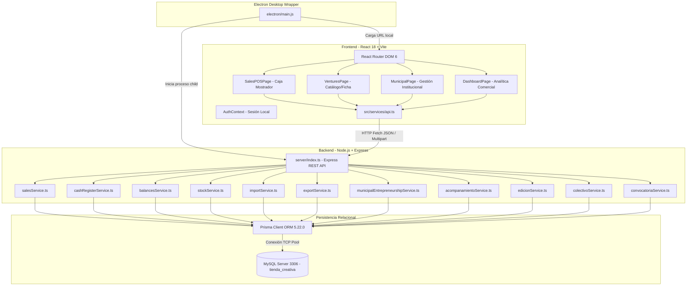
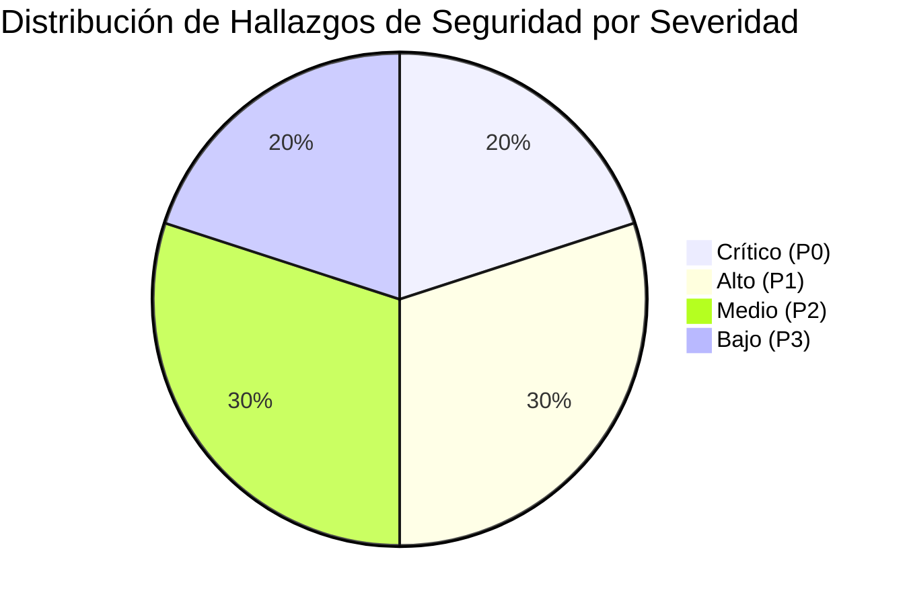

# Auditoría Técnica Integral — Tienda Creativa / Aplicación de Emprendedores
**Sistema de Gestión Comercial y Gestión Municipal de Emprendimientos**  
*Municipalidad de San Carlos de Bariloche*  
**Fecha de Relevamiento:** Octubre de 2026  
**Tipo de Documento:** Informe de Arquitectura, Auditoría Técnica y Diagnóstico Funcional  
**Estado:** Relevamiento Estático Exhaustivo y Verificación de Código Fuente  

---

## 1. Resumen Ejecutivo

El presente documento constituye la auditoría técnica integral y el relevamiento funcional del sistema **Tienda Creativa — Sistema de Gestión Comercial y Emprendimientos**, desarrollado para coordinar los puntos de venta físicos, la comercialización colectiva y el acompañamiento institucional de emprendedores locales bajo la órbita de la Municipalidad de San Carlos de Bariloche.

El relevamiento se realizó mediante análisis estático de código, inspección del esquema de persistencia Prisma, revisión de dependencias, auditoría de endpoints en Express, trazado de flujo de datos en React y verificación de la configuración de empaquetado en Electron.

### Conclusiones Principales del Diagnóstico:
1. **Doble Naturaleza del Sistema:** La plataforma combina dos subsistemas en una misma base de código:
   - Un **Módulo Comercial / Punto de Venta (POS)** altamente maduro, orientado al cobro en mostrador (efectivo y transferencias), apertura y arqueo de caja con doble encargado, seguimiento dinámico de stock y cálculo de saldos disponibles con retención municipal.
   - Un **Módulo de Gestión Municipal Institucional** con modelos de datos avanzados en Prisma (`Convocatoria`, `Colectivo`, `Edicion`, `Local`, `Fiscalizacion`, `Capacitacion`, `Reunion`, `PresenciaDigital`, `ServicioMunicipal`, `SeguimientoMunicipal`), servicios backend completos y una interfaz de usuario integrada (`MunicipalPage.tsx` y `VentureExpedienteModal.tsx`), pero **desconectado de las rutinas de respaldo (JSON) y exportación/sincronización multi-terminal**.
2. **Discrepancia Motor de Base de Datos / "Offline First":** La documentación y archivos históricos describen la aplicación como *"Offline First sobre SQLite"*, mientras que la implementación real utiliza **MySQL** como motor relacional primario (`prisma/schema.prisma` y `.env`), conectándose vía TCP a un servidor local `localhost:3306`. La aplicación no es un PWA con base de datos en el navegador; depende estrictamente de la disponibilidad del servicio MySQL en la máquina anfitriona.
3. **Seguridad y Control de Acceso:** La autenticación se encuentra implementada exclusivamente en el frontend (`src/context/AuthContext.tsx`) mediante credenciales estáticas predefinidas en código plano (`DEFAULT_USERS`) y almacenamiento en `localStorage`. **El backend Express no posee middleware de autenticación, validación de sesiones ni control de tokens JWT/Bearer en ninguno de sus más de 45 endpoints.** Cualquier cliente de red con acceso al puerto `3456` puede consultar, modificar o anular información sin restricciones.
4. **Integridad Comercial y Asimetría de Retenciones:** El stock se computa dinámicamente (`Stock = Movimientos - Ventas Activas`), evitando desfasajes por desincronización de campos redundantes. Sin embargo, existe una **asimetría contable crítica en el cálculo de saldos**: el porcentaje de retención municipal se calcula sobre las ventas totales (Efectivo + Transferencia), pero se descuenta en su totalidad del saldo de efectivo disponible, generando saldos negativos en caja cuando un emprendedor vende mayoritariamente por medios electrónicos.
5. **Aislamiento de la Información Municipal:** Las rutinas de respaldo completo (`generateJsonBackup`), exportación a Excel (`generateExcel`) y sincronización multi-local (`generateSyncJson` / `executeSyncImport`) operan **únicamente sobre las tablas comerciales**. Si se realiza una restauración o sincronización entre terminales, los datos institucionales (expedientes, fiscalizaciones, postulaciones, colectivos y redes sociales) quedan excluidos.

---

## 2. Estado General de la Aplicación

| Dimensión | Estado Real | Evidencia en Código | Nivel de Madurez |
| :--- | :--- | :--- | :--- |
| **Compilación TypeScript** | Limpia (0 errores) | `tsc --noEmit` exitoso sin advertencias | Alto |
| **Empaquetado Frontend** | Limpio (0 errores) | `vite build` genera bundle en 12s | Alto |
| **Servidor API Backend** | Operativo | Express en puerto 3456 (`server/index.ts`) | Medio-Alto |
| **Punto de Venta (POS)** | Operativo | `SalesPOSPage.tsx` con atajos, búsqueda y popup | Alto |
| **Apertura y Cierre de Caja** | Operativo | `cashRegisterService.ts`, arqueo con doble encargado | Alto |
| **Gestión Comercial de Emprendimientos** | Operativo | `VenturesPage.tsx` + `VentureDetailModal.tsx` | Alto |
| **Gestión Municipal** | Operativo en UI y API | `MunicipalPage.tsx` y servicios municipales | Medio-Alto |
| **Seguridad Backend** | Deficiente / Crítica | Endpoints desprotegidos en Express | Bajo (Riesgo Crítico) |
| **Respaldo Municipal** | Inexistente | `exportService.ts` no incluye tablas municipales | Bajo (Riesgo Alto) |
| **Contenedor Electron** | Funcional básico | `electron/main.js` lanza proceso Node y ventana | Medio |

---

## 3. Arquitectura Técnica

### 3.1 Stack Tecnológico Declarado y Versiones Reales

- **Frontend Core:** React `18.3.1`, React DOM `18.3.1`, React Router DOM `6.28.0`.
- **Lenguaje y Tipado:** TypeScript `5.6.3` con tipado estricto habilitado en `tsconfig.json`.
- **Herramienta de Construcción:** Vite `6.0.1` (`@vitejs/plugin-react` `4.3.4`).
- **Estilos y Maquetación:** Tailwind CSS `3.4.16`, PostCSS `8.4.49`, Autoprefixer `10.4.20`, Tailwind Merge `2.5.5`, Clsx `2.1.1`.
- **Iconografía:** Lucide React `0.468.0`.
- **Backend Core:** Node.js v22 (entorno de ejecución), Express `4.21.2`.
- **Ejecución TypeScript Backend:** TSX `4.19.2` (`tsx watch server/index.ts`).
- **ORM / Capa de Persistencia:** Prisma Client & CLI `5.22.0`.
- **Motor de Base de Datos:** MySQL (configurado en `prisma/schema.prisma` y `.env`).
- **Procesamiento de Archivos:** ExcelJS `4.4.0` (lectura y generación de hojas de cálculo), Multer `1.4.5-lts.1` (gestión de subida de archivos multipart en memoria).
- **Identificadores Únicos:** UUID `11.0.3` (para claves primarias e identificadores de sincronización).
- **Entorno de Escritorio:** Electron `33.2.1`.



### 3.2 Scripts Disponibles (`package.json`)

- `npm run dev`: Ejecuta concurrentemente `dev:server` y `dev:client`.
- `npm run dev:server`: Inicia la API con recarga automática usando `tsx watch server/index.ts`.
- `npm run dev:client`: Inicia el servidor de desarrollo Vite (`localhost:5173`).
- `npm run build:client`: Compila los assets estáticos del cliente en `dist/`.
- `npm run build`: Genera el cliente de Prisma (`prisma generate`) y compila el frontend.
- `npm run db:generate`: Genera los artefactos de Prisma Client a partir de `schema.prisma`.
- `npm run db:push`: Aplica cambios estructurales del esquema directamente en la base de datos MySQL.
- `npm run db:seed`: Ejecuta el script de siembra de datos de prueba (`server/seed.ts`).
- `npm run start`: Ejecuta el backend en modo directo (`tsx server/index.ts`).
- `npm run electron:dev`: Inicia el servidor API, el cliente Vite y la ventana de Electron en simultáneo.

### 3.3 Variables de Entorno Requeridas

El archivo `.env` en la raíz define los siguientes parámetros:
- `DATABASE_URL`: Cadena de conexión estándar para el proveedor MySQL (define protocolo, usuario, host, puerto, base de datos y parámetros de timeout).
- `PORT`: Puerto TCP donde escucha el servidor HTTP Express (por defecto `3456`).

### 3.4 Flujo de Inicio y Operación Offline

1. **Arranque por Script Bat (`iniciar_aplicacion.bat`):**
   - Ejecuta en segundo plano el servidor backend con `npx.cmd tsx server/index.ts`.
   - Espera un retardo de 2 segundos.
   - Abre el navegador predeterminado en `http://localhost:5173`.
   - Inicia el servidor Vite en primer plano.
2. **Arranque por Electron (`electron/main.js`):**
   - La función `startBackendServer()` inicia el proceso hijo ejecutando `server/index.ts`.
   - La función `createWindow()` crea la ventana principal del navegador Chromium (`BrowserWindow`) con resolución mínima de 1024x700.
   - En desarrollo, apunta a `http://localhost:5173`; en producción, carga el archivo estático empaquetado `dist/index.html`.
   - Configuración de seguridad en Electron: `nodeIntegration: false`, `contextIsolation: true`, `sandbox: true`. Al cerrar todas las ventanas, se envía señal de terminación (`kill()`) al proceso hijo del backend.
3. **Mito vs. Realidad del Modo Offline:**
   - La aplicación es **offline respecto a internet**: no consume APIs externas ni servicios en la nube para su operativa cotidiana.
   - La aplicación **no es offline-first a nivel de cliente**: si el servicio local de MySQL se detiene o no inicia, el frontend no puede funcionar (no utiliza bases de datos locales en navegador como IndexedDB ni service workers para cacheo de escrituras).

---

## 4. Estructura del Repositorio

```
Aplicacion Emprendedores/
├── .env                              # Variables de entorno (DATABASE_URL, PORT)
├── package.json                      # Manifiesto de dependencias y scripts de ejecución
├── tsconfig.json                     # Configuración TypeScript del frontend
├── tsconfig.node.json                # Configuración TypeScript para entorno Node/Vite
├── vite.config.ts                    # Configuración del bundler Vite
├── tailwind.config.js                # Definición de tokens de diseño y paleta municipal
├── postcss.config.js                 # Integración PostCSS
├── index.html                        # Contenedor HTML raíz de la SPA
├── iniciar_aplicacion.bat            # Lanzador para entornos Windows de mostrador
├── electron/
│   └── main.js                       # Proceso principal de Electron (lifecycle y ventanas)
├── prisma/
│   └── schema.prisma                 # Definición completa del modelo de datos relacional
├── public/                           # Recursos estáticos públicos (logos municipales, favicon)
├── server/
│   ├── db.ts                         # Instancia singleton de PrismaClient e initConfig
│   ├── index.ts                      # Servidor Express, middlewares y mapeo de rutas
│   ├── seed.ts                       # Script de carga inicial de datos de prueba
│   ├── verify_system.ts              # Script de verificación y pruebas estáticas de lógica
│   └── services/                     # Lógica de negocio modularizada en servicios
│       ├── acompanamientoService.ts   # Fiscalizaciones, capacitaciones, reuniones, seguimiento
│       ├── balancesService.ts         # Cálculo contable de saldos, retenciones y disponible
│       ├── cashRegisterService.ts     # Apertura, turnos, arqueo, ventas en vivo y cierre
│       ├── colectivoService.ts        # Comunidades y agrupaciones de emprendedores
│       ├── convocatoriaService.ts     # Convocatorias públicas y postulaciones
│       ├── edicionService.ts          # Eventos, ferias, locales físicos y participaciones
│       ├── entrepreneurService.ts     # ABM básico y toggle de estado de emprendimientos
│       ├── exportService.ts           # Generador de reportes Excel y payloads JSON
│       ├── importService.ts           # Procesador, parser y validador de Excel y JSON
│       ├── municipalAuditService.ts   # Registro de auditoría institucional
│       ├── municipalEntrepreneurshipService.ts # Expediente unificado e historial
│       ├── municipalStatisticsService.ts       # Métricas consolidadas municipales
│       ├── productService.ts          # Catálogo, stock dinámico y correlativos de código
│       ├── salesService.ts            # Creación atómica de ventas, cálculo y anulaciones
│       ├── statisticsService.ts       # Métricas de dashboard comercial
│       ├── stockService.ts            # Movimientos de inventario (ingresos, bajas, ajustes)
│       └── withdrawalService.ts       # Retiros de efectivo de emprendedores y anulación
└── src/
    ├── App.tsx                       # Enrutador principal, Providers y guardas de rol
    ├── main.tsx                      # Punto de entrada de React en el DOM
    ├── context/
    │   └── AuthContext.tsx           # Contexto de autenticación y sesión de usuario
    ├── components/
    │   ├── auth/ProtectedRoute.tsx   # Guardia de rutas según rol (ADMIN / EMPRENDEDOR)
    │   ├── layout/                   # Navbar, Sidebar colapsable y contenedor Layout
    │   ├── dashboards/               # Sub-dashboards de analítica comercial y gráficos
    │   ├── municipal/
    │   │   └── VentureExpedienteModal.tsx # Expediente institucional, timeline y trámites
    │   └── ventures/
    │       └── VentureDetailModal.tsx     # Ficha comercial integral (productos, ventas, retiros)
    ├── pages/
    │   ├── BalancesPage.tsx          # Panel contable de saldos disponibles y retiros rápidos
    │   ├── DashboardPage.tsx         # Tableros analíticos comerciales por período y filtro
    │   ├── ExportPage.tsx            # Descarga de Excel multichoja y JSON de sincronización
    │   ├── ImportPage.tsx            # Asistente de importación con previsualización y diff
    │   ├── LoginPage.tsx             # Pantalla de acceso con selección de perfil
    │   ├── MunicipalPage.tsx         # Módulo institucional completo (3.290 líneas)
    │   ├── ProductsPage.tsx          # (Ruta redundante / redirigida a emprendimientos)
    │   ├── SalesPOSPage.tsx          # Pantalla principal de Caja / Mostrador (2.162 líneas)
    │   ├── SettingsPage.tsx          # Configuración de terminal, turnos y retención defecto
    │   ├── StockPage.tsx             # (Ruta redundante / redirigida a emprendimientos)
    │   ├── VenturesPage.tsx          # Directorio general de emprendimientos
    │   └── WithdrawalsPage.tsx       # (Ruta redundante / redirigida a emprendimientos)
    ├── services/
    │   └── api.ts                    # Cliente HTTP tipado con wrappers para todos los endpoints
    ├── types/
    │   └── index.ts                  # Definiciones de tipos e interfaces TypeScript compartidas
    └── utils/
        └── formatters.ts             # Formateadores de moneda argentina y fechas
```

---

## 5. Inventario Funcional Completo

### 5.1 Matriz de Módulos del Sistema

| Módulo | Propósito Principal | Archivos Clave | Estado de Implementación | Roles Habilitados |
| :--- | :--- | :--- | :--- | :--- |
| **Autenticación y Sesión** | Control de acceso local y cambio de perfil | `AuthContext.tsx`, `LoginPage.tsx` | **Implementado en código** | Público / Todos |
| **Caja / Punto de Venta (POS)** | Facturación rápida en mostrador, atajos de teclado | `SalesPOSPage.tsx`, `salesService.ts` | **Implementado en código** | EMPRENDEDOR, ADMIN |
| **Sesiones de Caja y Arqueo** | Control de turno, fondo inicial, arqueo doble encargado | `cashRegisterService.ts`, `SalesPOSPage.tsx` | **Implementado en código** | EMPRENDEDOR, ADMIN |
| **Catálogo y Productos** | Mantenimiento de artículos, precios y correlativos | `productService.ts`, `VentureDetailModal.tsx` | **Implementado en código** | EMPRENDEDOR, ADMIN |
| **Control de Stock** | Movimientos de inventario, bajas justificadas | `stockService.ts`, `VentureDetailModal.tsx` | **Implementado en código** | EMPRENDEDOR, ADMIN |
| **Saldos y Liquidaciones** | Cálculo de retención municipal y saldo disponible | `balancesService.ts`, `BalancesPage.tsx` | **Problema detectado** *(asimetría retención)* | Solo ADMIN |
| **Retiros de Efectivo** | Pago de ventas a emprendedores en mostrador | `withdrawalService.ts`, `BalancesPage.tsx` | **Implementado en código** | Solo ADMIN |
| **Dashboards Comerciales** | Analítica de ventas, medios de pago y evolución | `DashboardPage.tsx`, `statisticsService.ts` | **Implementado en código** | Solo ADMIN |
| **Importación / Consolidación** | Incorporación de datos externos vía Excel y JSON | `ImportPage.tsx`, `importService.ts` | **Implementación parcial** *(solo comercial)* | EMPRENDEDOR, ADMIN |
| **Exportación de Datos** | Descarga de planillas Excel y JSON sync | `ExportPage.tsx`, `exportService.ts` | **Implementación parcial** *(solo comercial)* | EMPRENDEDOR, ADMIN |
| **Configuración de Terminal** | Parámetros de local, turno activo y stock negativo | `SettingsPage.tsx`, `server/index.ts` | **Implementado en código** | Solo ADMIN |
| **Gestión Municipal: Convocatorias** | Publicación de llamados y postulaciones | `convocatoriaService.ts`, `MunicipalPage.tsx` | **Implementado en código** | Solo ADMIN |
| **Gestión Municipal: Colectivos** | Agrupaciones temáticas de emprendedores | `colectivoService.ts`, `MunicipalPage.tsx` | **Implementado en código** | Solo ADMIN |
| **Gestión Municipal: Ediciones y Stands**| Planificación de ferias y asignación de puestos | `edicionService.ts`, `MunicipalPage.tsx` | **Implementado en código** | Solo ADMIN |
| **Gestión Municipal: Acompañamiento** | Fiscalizaciones, capacitaciones, reuniones, seguimiento| `acompanamientoService.ts`, `MunicipalPage.tsx` | **Implementado en código** | Solo ADMIN |
| **Gestión Municipal: Redes Sociales** | Seguimiento de presencia digital e Instagram | `acompanamientoService.ts`, `MunicipalPage.tsx` | **Implementado en código** | Solo ADMIN |
| **Expediente Municipal Unificado** | Línea de tiempo completa por emprendimiento | `municipalEntrepreneurshipService.ts`, `VentureExpedienteModal.tsx` | **Implementado en código** | Solo ADMIN |
| **Auditoría Administrativa** | Registro inmutable de operaciones y cambios de estado | `AuditoriaLog`, `municipalAuditService.ts` | **Implementado en código** | Solo ADMIN |

### 5.2 Detalle de Reglas de Negocio Verificadas

1. **Cálculo de Código de Producto Correlativo (`productService.ts:L135-L175`):**
   - El código de producto se forma estrictamente con el prefijo oficial del emprendimiento (ej. `AKM`) más un número correlativo de 3 dígitos (`001`, `002`, `003`).
   - El sistema analiza los productos existentes mediante expresiones regulares sobre el prefijo, obtiene el número máximo registrado e incrementa en 1, rellenando con ceros a la izquierda.
2. **Doble Encargado Obligatorio al Abrir Caja (`cashRegisterService.ts:L128-L145`):**
   - Para iniciar un turno de caja es obligatorio seleccionar dos emprendimientos registrados distintos (`encargado1Id !== encargado2Id`).
   - Se guarda el texto explicativo de quiénes estuvieron a cargo en `encargadosTexto` y se registra en la auditoría inmutable.
3. **Cálculo Dinámico de Stock en Tiempo Real (`productService.ts:L114-L129`):**
   $$\text{Stock Disponible} = \sum(\text{MovimientoStock.cantidad}) - \sum(\text{Venta[ACTIVO].cantidad})$$
   - Las ventas no restan stock insertando filas en `MovimientoStock`; se computan en tiempo de consulta.
   - Las anulaciones de venta (`estado = 'ANULADO'`) reponen el stock inmediatamente sin requerir transacciones de ajuste adicionales.
4. **Validación de Sobregiro de Retiros (`withdrawalService.ts:L30-L35`):**
   - No se permite registrar un retiro superior al `saldoEfectivoDisponible` salvo que se especifique explícitamente el flag `permitirExcedente: true` (autorización especial para saldo deudor/anticipo).
5. **Deduplicación Estricta en Sincronización Multi-Local (`importService.ts:L789-L996`):**
   - Se utiliza `identificadorUnico` para ventas y retiros, `operacionUuid` para movimientos de inventario y `codigo` para emprendimientos y productos.
   - Si un registro ya existe en la base receptora, se ignora la inserción sin abortar el resto del lote.

---

## 6. Auditoría del Modelo de Datos

### 6.1 Inventario de Modelos Prisma (`prisma/schema.prisma`)

El esquema relacional cuenta con **25 modelos** estructurados en dos grandes dominios:

```mermaid
erDiagram
    CONFIGURACION {
        string id PK
        string localCodigo
        string localNombre
        boolean permitirStockNegativo
        float porcentajeRetencionDefecto
        string turnoActual
    }

    EMPRENDIMIENTO ||--o{ PRODUCTO : posee
    EMPRENDIMIENTO ||--o{ VENTA : genera
    EMPRENDIMIENTO ||--o{ RETIRO : realiza
    EMPRENDIMIENTO ||--o{ POSTULACION : postula
    EMPRENDIMIENTO ||--o{ EMPRENDIMIENTO_COLECTIVO : integra
    EMPRENDIMIENTO ||--o{ EDICION_EMPRENDIMIENTO : participa
    EMPRENDIMIENTO ||--o{ FISCALIZACION : recibe
    EMPRENDIMIENTO ||--o{ EMPRENDIMIENTO_CAPACITACION : asiste
    EMPRENDIMIENTO ||--o{ REUNION_MUNICIPAL : mantiene
    EMPRENDIMIENTO ||--o{ PRESENCIA_DIGITAL : registra
    EMPRENDIMIENTO ||--o{ EMPRENDIMIENTO_SERVICIO : recibe
    EMPRENDIMIENTO ||--o{ SEGUIMIENTO_MUNICIPAL : es_objeto_de

    PRODUCTO ||--o{ MOVIMIENTO_STOCK : registra
    PRODUCTO ||--o{ VENTA : vendido_en
    PRODUCTO ||--o{ FISCALIZACION : inspeccionado_en

    CONVOCATORIA ||--o{ POSTULACION : agrupa
    COLECTIVO ||--o{ EMPRENDIMIENTO_COLECTIVO : contiene
    COLECTIVO ||--o{ EDICION_EMPRENDIMIENTO : asignado_a

    EDICION ||--o{ EDICION_LOCAL : habilita
    LOCAL ||--o{ EDICION_LOCAL : forma_parte
    EDICION ||--o{ EDICION_EMPRENDIMIENTO : programa
    LOCAL ||--o{ EDICION_EMPRENDIMIENTO : asignado_en

    CAPACITACION ||--o{ EMPRENDIMIENTO_CAPACITACION : inscribe
    SERVICIO_MUNICIPAL ||--o{ EMPRENDIMIENTO_SERVICIO : otorga

    SESION_CAJA {
        string id PK
        string identificadorUnico UK
        float montoInicial
        datetime fechaApertura
        datetime fechaCierre
        string turno
        string encargado1Id
        string encargado2Id
        float montoRealContado
        float diferencia
        string estado
    }

    AUDITORIA_LOG {
        string id PK
        string entidad
        string entidadId
        string accion
        string usuario
        text detallesJson
        datetime fecha
    }

    HISTORIAL_IMPORTACION {
        string id PK
        string nombreArchivo
        string archivoHash
        int totalFilas
        datetime fecha
    }
```



### 6.2 Descripción de Modelos y Restricciones

1. **`Configuracion`:** Tabla singleton (`id: "config_default"`). Parámetros de terminal, prefijo de local, reglas de stock negativo y turno.
2. **`Emprendimiento`:** Entidad permanente. Clave primaria UUID. Clave única natural: `codigo` (Código Oficial Municipal). Índices en `codigo`, `activo` y `estado`.
3. **`Producto`:** Artículos comercializables. Clave única `codigo` (`AKM001`). Llave foránea `emprendimientoId`. Campo `precio` de tipo Float.
4. **`MovimientoStock`:** Libro mayor de existencias. Clave única `operacionUuid` para sincronización. `cantidad` (entero con signo positivo o negativo).
5. **`Venta`:** Operación de mostrador. Clave única `identificadorUnico` (`LOCAL-TIMESTAMP-RAND`). Contiene snapshot inmutable de `precioUnitario`, `descuento` y `total`. Estados: `ACTIVO`, `ANULADO`.
6. **`Retiro`:** Salida de fondos para liquidación al emprendedor. Clave única `identificadorUnico`. Estados: `ACTIVO`, `ANULADO`.
7. **`SesionCaja`:** Registro de jornada de caja. Clave única `identificadorUnico`. Relaciona opcionalmente `encargado1Id` y `encargado2Id` como strings UUID de emprendimientos.
8. **`AuditoriaLog`:** Bitácora inmutable de eventos comerciales y administrativos. Almacena snapshots JSON en `detallesJson`.
9. **`HistorialImportacion`:** Registro de archivos importados con hash criptográfico SHA-256 (`archivoHash`) para evitar re-importaciones accidentales.
10. **Modelos Municipales (`Convocatoria`, `Postulacion`, `Colectivo`, `EmprendimientoColectivo`, `Local`, `Edicion`, `EdicionLocal`, `EdicionEmprendimiento`, `Fiscalizacion`, `Capacitacion`, `EmprendimientoCapacitacion`, `ReunionMunicipal`, `PresenciaDigital`, `ServicioMunicipal`, `EmprendimientoServicio`, `SeguimientoMunicipal`):** Estructura normalizada con claves compuestas en tablas pivote (ej. `@@unique([convocatoriaId, emprendimientoId])`, `@@unique([capacitacionId, emprendimientoId])`, `@@unique([edicionId, localId])`).

---

## 7. Auditoría Específica de Emprendimientos

El módulo de emprendimientos es el eje conector de toda la plataforma:

### 7.1 Regla del Código Oficial Municipal
- **Comportamiento Actual:** El campo `codigo` es un `String` con restricción `@unique`. En la creación (`entrepreneurService.ts:L31-L40` y `municipalEntrepreneurshipService.ts:L114-L127`), se valida obligatoriamente que sea provisto por el usuario, se limpia con `.trim().toUpperCase()` y se verifica que no exista en la base de datos.
- **Inmutabilidad y Respeto Institucional:** Los códigos no son generados por auto-incremento ni secuencias arbitrarias; responden al nomenclador municipal oficial (ej. `AKM`, `TDE`, `EMP-025`). El sistema respeta esta regla y no los sobreescribe.

### 7.2 Atributos Registrados

```typescript
// Campos soportados en base de datos (prisma/schema.prisma:L20-L60)
{
  codigo: string;               // Código oficial único (ej: "AKM")
  nombre: string;               // Nombre comercial del taller
  nombreFantasia?: string;      // Nombre de fantasía opcional
  responsable: string;          // Nombre y apellido del titular
  documento?: string;           // DNI / Pasaporte
  cuit?: string;                // CUIT / CUIL
  telefono?: string;            // Teléfono / WhatsApp (ej: 542944...)
  direccion?: string;           // Domicilio físico
  alias?: string;               // Alias de Mercado Pago / Banco
  cvu?: string;                 // Clave Virtual Uniforme
  cbu?: string;                 // Clave Bancaria Uniforme
  mail?: string;                // Correo electrónico
  rubro?: string;               // Cerámica, Textil, Joyería, etc.
  descripcion?: string;         // Descripción de la técnica o productos
  porcentajeRetencion: number;  // Comisión municipal de retención (ej: 10.0%)
  activo: boolean;              // Bandera booleana rápida de actividad
  estado: string;               // "ACTIVO" | "INACTIVO" | "SUSPENDIDO" | "FINALIZADO"
}
```

### 7.3 Interacción con Otros Módulos
- **En Ventas:** El cajero puede filtrar productos seleccionando primero el emprendimiento o ingresando el código del producto (cuyo prefijo es el código del emprendimiento). En ventas por transferencia, el sistema muestra y permite copiar el Alias/CVU del emprendimiento seleccionado.
- **En Stock:** Cada producto pertenece estrictamente a un único emprendimiento (`producto.emprendimientoId`).
- **En Saldos y Retiros:** Los retiros se imputan directamente a la cuenta del emprendimiento y deducen su saldo disponible.
- **En Gestión Municipal:** Todos los trámites (postulaciones a ferias, actas de fiscalización, capacitaciones, reuniones de seguimiento y presencia digital) se vinculan directamente mediante `emprendimientoId`. **No existe duplicación de entidades:** el mismo registro que cobra en mostrador es el que figura en el expediente municipal institucional.

---

## 8. Auditoría del Backend y la API

El archivo `server/index.ts` expone **47 rutas HTTP** sobre Express:

### 8.1 Tabla de Endpoints Disponibles

| Método | Ruta | Servicio Invocado | Autenticación en Servidor | Estado de Implementación |
| :--- | :--- | :--- | :--- | :--- |
| `GET` | `/api/config` | `prisma.configuracion.findFirst()` | Ninguna (Público) | Implementado en código |
| `PUT` | `/api/config` | `prisma.configuracion.upsert()` | Ninguna (Público) | Implementado en código |
| `GET` | `/api/entrepreneurs` | `entrepreneurService.getAll()` | Ninguna (Público) | Implementado en código |
| `GET` | `/api/entrepreneurs/:id`| `entrepreneurService.getById()` | Ninguna (Público) | Implementado en código |
| `POST`| `/api/entrepreneurs` | `entrepreneurService.create()` | Ninguna (Público) | Implementado en código |
| `PUT` | `/api/entrepreneurs/:id`| `entrepreneurService.update()` | Ninguna (Público) | Implementado en código |
| `PATCH`| `/api/entrepreneurs/:id/toggle` | `entrepreneurService.toggleActivo()` | Ninguna (Público) | Implementado en código |
| `GET` | `/api/products` | `productService.getAll()` | Ninguna (Público) | Implementado en código |
| `GET` | `/api/products/next-code/:id` | `productService.generateNextCode()` | Ninguna (Público) | Implementado en código |
| `GET` | `/api/products/code/:code` | `productService.getByCode()` | Ninguna (Público) | Implementado en código |
| `GET` | `/api/products/:id` | `productService.getById()` | Ninguna (Público) | Implementado en código |
| `POST`| `/api/products` | `productService.create()` | Ninguna (Público) | Implementado en código |
| `PUT` | `/api/products/:id` | `productService.update()` | Ninguna (Público) | Implementado en código |
| `PATCH`| `/api/products/:id/toggle` | `productService.toggleActivo()` | Ninguna (Público) | Implementado en código |
| `GET` | `/api/stock/movements` | `stockService.getMovements()` | Ninguna (Público) | Implementado en código |
| `POST`| `/api/stock/movements` | `stockService.createMovement()` | Ninguna (Público) | Implementado en código |
| `GET` | `/api/stock/low` | `stockService.getLowStockProducts()` | Ninguna (Público) | Implementado en código |
| `GET` | `/api/sales` | `salesService.getSales()` | Ninguna (Público) | Implementado en código |
| `POST`| `/api/sales` | `salesService.createSale()` | Ninguna (Público) | Implementado en código |
| `POST`| `/api/sales/:id/void` | `salesService.voidSale()` | Ninguna (Público) | Implementado en código |
| `GET` | `/api/caja/sesion-actual`| `cashRegisterService.getCurrentSession()` | Ninguna (Público) | Implementado en código |
| `POST`| `/api/caja/abrir` | `cashRegisterService.openRegister()` | Ninguna (Público) | Implementado en código |
| `POST`| `/api/caja/cerrar` | `cashRegisterService.closeRegister()` | Ninguna (Público) | Implementado en código |
| `POST`| `/api/caja/cerrar-abiertas` | `cashRegisterService.closeAnyOpenSession()` | Ninguna (Público) | Implementado en código |
| `GET` | `/api/caja/ventas-dia` | `cashRegisterService.getDailySalesStats()` | Ninguna (Público) | Implementado en código |
| `GET` | `/api/caja/historial` | `cashRegisterService.getSessionHistory()` | Ninguna (Público) | Implementado en código |
| `GET` | `/api/withdrawals` | `withdrawalService.getWithdrawals()` | Ninguna (Público) | Implementado en código |
| `POST`| `/api/withdrawals` | `withdrawalService.createWithdrawal()` | Ninguna (Público) | Implementado en código |
| `POST`| `/api/withdrawals/:id/void` | `withdrawalService.voidWithdrawal()` | Ninguna (Público) | Implementado en código |
| `GET` | `/api/balances` | `balancesService.getBalances()` | Ninguna (Público) | Implementado en código |
| `GET` | `/api/balances/:id` | `balancesService.getBalanceByEntrepreneurId()` | Ninguna (Público) | Implementado en código |
| `GET` | `/api/statistics/dashboard` | `statisticsService.getDashboardStats()` | Ninguna (Público) | Implementado en código |
| `GET` | `/api/export/excel` | `exportService.generateExcel()` | Ninguna (Público) | Implementado en código |
| `GET` | `/api/export/json` | `exportService.generateJsonBackup()` | Ninguna (Público) | Implementado en código |
| `GET` | `/api/export/sync-json`| `exportService.generateSyncJson()` | Ninguna (Público) | Implementado en código |
| `POST`| `/api/import/preview` | `importService.previewFile()` | Ninguna (Público) | Implementado en código |
| `POST`| `/api/import/confirm` | `importService.executeSyncImport()` | Ninguna (Público) | Implementado en código |
| `GET` | `/api/municipal/dashboard` | `municipalStatisticsService.getDashboardStats()` | Ninguna (Público) | Implementado en código |
| `GET` | `/api/municipal/auditoria` | `municipalAuditService.getAuditLogs()` | Ninguna (Público) | Implementado en código |
| `GET` | `/api/municipal/emprendimientos` | `municipalEntrepreneurshipService.getAll()` | Ninguna (Público) | Implementado en código |
| `GET` | `/api/municipal/emprendimientos/:id` | `municipalEntrepreneurshipService.getById()` | Ninguna (Público) | Implementado en código |
| `GET` | `/api/municipal/emprendimientos/:id/expediente` | `municipalEntrepreneurshipService.getExpediente()` | Ninguna (Público) | Implementado en código |
| `POST`| `/api/municipal/emprendimientos` | `municipalEntrepreneurshipService.create()` | Ninguna (Público) | Implementado en código |
| `PUT` | `/api/municipal/emprendimientos/:id` | `municipalEntrepreneurshipService.update()` | Ninguna (Público) | Implementado en código |
| `GET` | `/api/municipal/convocatorias` | `convocatoriaService.getAllConvocatorias()` | Ninguna (Público) | Implementado en código |
| `POST`| `/api/municipal/convocatorias` | `convocatoriaService.createConvocatoria()` | Ninguna (Público) | Implementado en código |
| `PUT` | `/api/municipal/convocatorias/:id` | `convocatoriaService.updateConvocatoria()` | Ninguna (Público) | Implementado en código |
| `GET` | `/api/municipal/postulaciones` | `convocatoriaService.getPostulaciones()` | Ninguna (Público) | Implementado en código |
| `POST`| `/api/municipal/postulaciones` | `convocatoriaService.createPostulacion()` | Ninguna (Público) | Implementado en código |
| `PUT` | `/api/municipal/postulaciones/:id/estado` | `convocatoriaService.updatePostulacionEstado()` | Ninguna (Público) | Implementado en código |
| `GET` | `/api/municipal/colectivos` | `colectivoService.getAllColectivos()` | Ninguna (Público) | Implementado en código |
| `POST`| `/api/municipal/colectivos` | `colectivoService.createColectivo()` | Ninguna (Público) | Implementado en código |
| `PUT` | `/api/municipal/colectivos/:id` | `colectivoService.updateColectivo()` | Ninguna (Público) | Implementado en código |
| `POST`| `/api/municipal/colectivos/:id/miembros` | `colectivoService.addMiembro()` | Ninguna (Público) | Implementado en código |
| `PUT` | `/api/municipal/colectivos/miembros/:id/baja` | `colectivoService.removeMiembro()` | Ninguna (Público) | Implementado en código |
| `GET` | `/api/municipal/locales` | `edicionService.getAllLocales()` | Ninguna (Público) | Implementado en código |
| `POST`| `/api/municipal/locales` | `edicionService.createLocal()` | Ninguna (Público) | Implementado en código |
| `PUT` | `/api/municipal/locales/:id` | `edicionService.updateLocal()` | Ninguna (Público) | Implementado en código |
| `GET` | `/api/municipal/ediciones` | `edicionService.getAllEdiciones()` | Ninguna (Público) | Implementado en código |
| `POST`| `/api/municipal/ediciones` | `edicionService.createEdicion()` | Ninguna (Público) | Implementado en código |
| `PUT` | `/api/municipal/ediciones/:id` | `edicionService.updateEdicion()` | Ninguna (Público) | Implementado en código |
| `POST`| `/api/municipal/participaciones` | `edicionService.addParticipacion()` | Ninguna (Público) | Implementado en código |
| `PUT` | `/api/municipal/participaciones/:id/estado` | `edicionService.updateParticipacionEstado()` | Ninguna (Público) | Implementado en código |
| `GET` | `/api/municipal/fiscalizaciones` | `acompanamientoService.getFiscalizaciones()` | Ninguna (Público) | Implementado en código |
| `POST`| `/api/municipal/fiscalizaciones` | `acompanamientoService.createFiscalizacion()` | Ninguna (Público) | Implementado en código |
| `GET` | `/api/municipal/capacitaciones` | `acompanamientoService.getAllCapacitaciones()` | Ninguna (Público) | Implementado en código |
| `POST`| `/api/municipal/capacitaciones` | `acompanamientoService.createCapacitacion()` | Ninguna (Público) | Implementado en código |
| `POST`| `/api/municipal/capacitaciones/:id/participantes`| `acompanamientoService.addParticipanteCapacitacion()` | Ninguna (Público) | Implementado en código |
| `GET` | `/api/municipal/reuniones` | `acompanamientoService.getReuniones()` | Ninguna (Público) | Implementado en código |
| `POST`| `/api/municipal/reuniones` | `acompanamientoService.createReunion()` | Ninguna (Público) | Implementado en código |
| `GET` | `/api/municipal/redes-sociales` | `acompanamientoService.getAllRedesSociales()` | Ninguna (Público) | Implementado en código |
| `GET` | `/api/municipal/emprendimientos/:id/presencia-digital` | `acompanamientoService.getPresenciaDigital()` | Ninguna (Público) | Implementado en código |
| `POST`| `/api/municipal/presencia-digital` | `acompanamientoService.upsertPresenciaDigital()` | Ninguna (Público) | Implementado en código |
| `PUT` | `/api/municipal/presencia-digital/:id` | `acompanamientoService.updatePresenciaDigital()` | Ninguna (Público) | Implementado en código |
| `PUT` | `/api/municipal/presencia-digital/:id/seguidores` | `acompanamientoService.updateSeguidores()` | Ninguna (Público) | Implementado en código |
| `DELETE`| `/api/municipal/presencia-digital/:id` | `acompanamientoService.deletePresenciaDigital()` | Ninguna (Público) | Implementado en código |
| `GET` | `/api/municipal/servicios` | `acompanamientoService.getAllServiciosMunicipales()` | Ninguna (Público) | Implementado en código |
| `POST`| `/api/municipal/servicios` | `acompanamientoService.createServicioMunicipal()` | Ninguna (Público) | Implementado en código |
| `GET` | `/api/municipal/servicios-otorgados` | `acompanamientoService.getServiciosOtorgados()` | Ninguna (Público) | Implementado en código |
| `POST`| `/api/municipal/servicios-otorgados` | `acompanamientoService.otorgarServicio()` | Ninguna (Público) | Implementado en código |
| `GET` | `/api/municipal/seguimientos` | `acompanamientoService.getSeguimientos()` | Ninguna (Público) | Implementado en código |
| `POST`| `/api/municipal/seguimientos` | `acompanamientoService.createSeguimiento()` | Ninguna (Público) | Implementado en código |

---

## 9. Auditoría de Seguridad

### Hallazgos de Seguridad Clasificados por Severidad



#### Hallazgo SEC-01 — [CRÍTICO]: Inexistencia de Autenticación y Autorización en la API Backend
- **Ubicación:** `server/index.ts:L24-L32` y `src/context/AuthContext.tsx:L17-L30`.
- **Evidencia Técnica:** El servidor Express inicializa sin ningún middleware de autenticación (no hay JWT, cookies de sesión, tokens de API ni validación de headers `Authorization`). La seguridad por roles (`adminOnly`) existe únicamente como directiva visual en el cliente React (`ProtectedRoute.tsx` y `Sidebar.tsx`).
- **Impacto:** Cualquier usuario conectado a la red local (o un proceso en la máquina) puede enviar un `POST /api/withdrawals` para registrar extracciones ficticias, anular ventas o alterar datos de emprendimientos mediante llamadas HTTP directas con herramientas como `curl` o Postman.
- **Recomendación:** Implementar tokens de sesión firmados (JWT o sesiones seguras de Express en cookie HTTP-Only) y un middleware que valide identidad y rol antes de ejecutar handlers en `server/index.ts`.

#### Hallazgo SEC-02 — [CRÍTICO]: Credenciales Predefinidas en Código Plano en el Cliente
- **Ubicación:** `src/context/AuthContext.tsx:L17-L30`.
- **Evidencia Técnica:** Las credenciales de acceso están declaradas en una constante exportada (`DEFAULT_USERS`) con nombres de usuario y contraseñas legibles en el código fuente:
  ```typescript
  export const DEFAULT_USERS = [
    { username: 'emprendedor', password: '...', role: 'EMPRENDEDOR' },
    { username: 'admin', password: '...', role: 'ADMIN' },
  ];
  ```
- **Impacto:** Cualquier operador con acceso a las herramientas de desarrollador del navegador (`DevTools`) o que inspeccione el código compilado puede ver las claves de acceso de administrador municipal.
- **Recomendación:** Migrar la gestión de usuarios y contraseñas a una tabla en base de datos (`Usuario`), almacenando contraseñas con hashing criptográfico (`bcrypt` o `argon2`), y autenticar contra el servidor.

#### Hallazgo SEC-03 — [ALTO]: Exposición de Datos Financieros y Personales sin Restricción
- **Ubicación:** `server/services/entrepreneurService.ts`, `server/services/municipalEntrepreneurshipService.ts` y endpoints `/api/entrepreneurs`.
- **Evidencia Técnica:** Las respuestas JSON devuelven documentos de identidad (DNI), CUIT, teléfonos, direcciones físicas, Alias de Mercado Pago, CVU y CBU a cualquier consulta no autenticada.
- **Impacto:** Incumplimiento de normativas de protección de datos personales (Ley 25.326). Riesgo de exfiltración de información sensible de emprendedores locales.
- **Recomendación:** Filtrar campos sensibles según el rol del usuario autenticado; restringir CBU/CVU y documentos a operadores autorizados.

#### Hallazgo SEC-04 — [ALTO]: Configuración CORS Completamente Abierta
- **Ubicación:** `server/index.ts:L27`.
- **Evidencia Técnica:** `app.use(cors())` sin parámetros permite cualquier origen (`*`).
- **Impacto:** Si la máquina de mostrador navega en un sitio web malicioso en segundo plano mientras el servidor local corre en el puerto 3456, un script web externo puede realizar peticiones cross-origin a `http://localhost:3456/api/...` y extraer o manipular la base de datos comercial.
- **Recomendación:** Restringir el origen en CORS exclusivamente a `http://localhost:5173` y los orígenes de la aplicación empaquetada.

#### Hallazgo SEC-05 — [MEDIO]: Ausencia de Rate Limiting y Control de Carga
- **Ubicación:** `server/index.ts`.
- **Evidencia Técnica:** No se utiliza `express-rate-limit`. El límite del body parser está establecido en 50 MB (`express.json({ limit: '50mb' })`).
- **Impacto:** Peticiones concurrentes masivas o envíos repetidos de buffers pesados pueden saturar la memoria del proceso Node.js y congelar la terminal de caja.
- **Recomendación:** Añadir rate limiting en endpoints de consulta y reducir el límite de JSON a tamaños acordes (ej. 2 MB para peticiones estándar y límite mayor solo en importaciones).

---

## 10. Auditoría de Integridad Comercial

### 10.1 La Asimetría Contable de la Retención Municipal

En `server/services/balancesService.ts:L71-L75`, se calcula la liquidación a los emprendedores:

```typescript
// Código real en server/services/balancesService.ts
const retencionPorc = emp.porcentajeRetencion || 0;
const montoRetencion = Math.round((ventasTotales * retencionPorc) / 100 * 100) / 100;
const saldoEfectivoDisponible = Math.round((ventasEfectivo - totalRetiros - montoRetencion) * 100) / 100;
```

**Análisis del Defecto Contable:**
- `ventasTotales = ventasEfectivo + ventasTransferencia`.
- El municipio aplica su retención sobre el total comercializado (`ventasTotales`).
- Sin embargo, **la retención se descuenta íntegramente de la cuenta de efectivo** (`ventasEfectivo - totalRetiros - montoRetencion`).
- **Escenario de Falla:** Un emprendedor realiza ventas por transferencia por \$100.000 y ventas en efectivo por \$5.000, con una retención del 10%:
  - Retención total = 10% de \$105.000 = \$10.500.
  - Saldo efectivo disponible = \$5.000 - \$0 - \$10.500 = **-\$5.500**.
  - El sistema muestra que el emprendedor tiene saldo negativo de efectivo disponible y bloquea retiros de efectivo, a pesar de que el emprendedor generó \$100.000 que ingresaron a la cuenta bancaria. Además, el sistema **no posee un mecanismo para liquidar o asentar los pagos de las ventas por transferencia** (no existe un modelo `LiquidacionBancaria` ni registro de transferencias emitidas por el municipio al CBU del emprendedor).

### 10.2 Control de Transacciones Atómicas (ACID)
- **Ventas (`salesService.ts:L76-L129`):** Implementada correctamente con `prisma.$transaction`. Verifica stock y genera la venta y el registro de auditoría en un único bloque atómico.
- **Retiros (`withdrawalService.ts:L40-L68`):** Se ejecuta en dos operaciones separadas (`prisma.retiro.create` y `prisma.auditoriaLog.create`). Si el logging falla, el retiro persiste pero sin trazabilidad. Debería encapsularse en `$transaction`.
- **Importación (`importService.ts:L768-L1005`):** Implementada dentro de una macro-transacción Prisma. Si alguna fila corrompe la base, la importación se revierte por completo, garantizando cero estados a medio cargar.

---

## 11. Importación, Exportación y Respaldos

### 11.1 Comparación de Capacidades por Formato

| Característica | Archivo Excel (`.xlsx`) | Archivo JSON Sync (`.json`) | Backup Completo (`.json`) |
| :--- | :--- | :--- | :--- |
| **Generador** | `exportService.generateExcel()` | `exportService.generateSyncJson()` | `exportService.generateJsonBackup()` |
| **Receptor / Parser** | `importService.previewImportExcel()` | `importService.previewSyncJson()` | Inexistente (no hay restaurador directo) |
| **Hojas / Entidades Exportadas** | Ventas, Stock, Retiros, Saldos, Emprendimientos, Productos | Emprendimientos, Productos, MovimientosStock, Ventas, Retiros, SesionesCaja | Config, Emprendimientos, Productos, MovimientosStock, Ventas, Retiros, Auditoria |
| **Entidades que Puede Importar** | **Solo Ventas y Retiros** | Emprendimientos, Productos, MovimientosStock, Ventas, Retiros, SesionesCaja | N/A |
| **Control de Duplicados** | Compara `identificadorUnico` en memoria | Compara claves únicas e ID con hash SHA-256 | N/A |
| **Datos Municipales Incluidos** | **Ninguno (0%)** | **Ninguno (0%)** | **Ninguno (0%)** |
| **Apto para Reinstalación Total** | No (solo histórico de ventas/retiros) | Parcial (solo operativo comercial) | No sin script de migración manual |

### 11.2 Brechas Críticas Detectadas:
1. **La importación de Excel no importa stock ni productos:** Aunque la exportación genera las hojas `Stock`, `Productos` y `Emprendimientos`, la rutina de lectura de Excel (`importService.ts:L510-L525`) solo procesa las hojas tituladas `Ventas` y `Retiros`. Si un usuario intenta restaurar o cargar un catálogo desde el Excel exportado, el sistema rechaza el archivo indicando que no contiene ventas ni retiros compatibles.
2. **Invisibilidad de la Gestión Municipal:** Las tablas de convocatorias, postulaciones, colectivos, stands físicos, eventos, actas de fiscalización, capacitaciones y redes sociales **no son exportadas por ninguna de las herramientas del sistema**. Si se extrae un JSON para llevar a otra computadora o hacer un respaldo, se pierde toda la información institucional generada en la pestaña de Gestión Municipal.

---

## 12. Interfaz y Experiencia de Usuario (UI/UX)

### 12.1 Arquitectura Visual y Navegación
- **Estilo Visual:** Coherente y profesional, basado en Tailwind CSS con la paleta de colores oficial de la Municipalidad de Bariloche (naranja institucional `#ea580c` / `#f97316`, fondo pizarra `#f8fafc` y paneles blancos con bordes sutiles y radios curvos `rounded-2xl` y `rounded-3xl`).
- **Sidebar Colapsable:** Implementado con detección de hover y botón de fijado manual persistido en `localStorage` (`sidebar_pinned`).
- **Consolidación de Menú:** Las rutas obsoletas `/productos`, `/stock` y `/retiros` están redirigidas en `App.tsx` hacia `/emprendimientos`. Toda la gestión de catálogo y stock de un emprendedor se realiza directamente desde su ficha integral (`VentureDetailModal.tsx`), lo cual reduce la dispersión de pantallas.

### 12.2 Experiencia en Caja / Mostrador (`SalesPOSPage.tsx`)
- **Puntos Fuertes:**
  - Selector rápido de turnos (Mañana / Tarde).
  - Bloque prominente de apertura y cierre de caja con arqueo ciego (el cajero cuenta el dinero sin ver el monto esperado hasta confirmar el cierre).
  - Búsqueda dual: por código correlativo directo (ej. `AKM001`) o por nombre de producto / emprendimiento.
  - Selección de porcentaje de descuento rápido (5%, 10%, 15%, 20%) o monto fijo.
  - Pop-up de confirmación de venta claro con resumen de artículos y desglose de medios de pago.
- **Dificultades Detectadas:**
  - En resoluciones de pantalla reducidas (laptops de 1366x768 habituales en mostradores municipales), los componentes del POS requieren scrolling vertical excesivo debido al tamaño de tarjetas y paddings generosos.
  - El archivo `SalesPOSPage.tsx` supera las 2.100 líneas, mezclando estado de caja, modales de arqueo, reportes del día, selección de productos y procesamiento de venta en un único archivo React.

---

## 13. Preparación para Gestión Municipal

### 13.1 Evaluación Conceptual y Estado Real en Código

A diferencia de lo asumido en planes previos, **el módulo municipal ya cuenta con una implementación preliminar extensa en el repositorio**:

| Concepto Municipal | ¿Existe Modelo Prisma? | ¿Existe Servicio Backend? | ¿Existe Endpoint API? | ¿Existe Interfaz Frontend? | Estado Real |
| :--- | :--- | :--- | :--- | :--- | :--- |
| **Emprendimientos** | Sí (`Emprendimiento`) | Sí (`entrepreneurService`, `municipalEntrepreneurshipService`) | Sí (`/api/municipal/emprendimientos`) | Sí (`VenturesPage`, `MunicipalPage`) | **Implementado y unificado** |
| **Convocatorias** | Sí (`Convocatoria`) | Sí (`convocatoriaService`) | Sí (`/api/municipal/convocatorias`) | Sí (`MunicipalPage`) | **Implementado en código** |
| **Postulaciones** | Sí (`Postulacion`) | Sí (`convocatoriaService`) | Sí (`/api/municipal/postulaciones`) | Sí (`MunicipalPage`, `VentureExpedienteModal`) | **Implementado en código** |
| **Colectivos** | Sí (`Colectivo`, `EmprendimientoColectivo`)| Sí (`colectivoService`) | Sí (`/api/municipal/colectivos`) | Sí (`MunicipalPage`) | **Implementado en código** |
| **Ediciones y Eventos** | Sí (`Edicion`) | Sí (`edicionService`) | Sí (`/api/municipal/ediciones`) | Sí (`MunicipalPage`) | **Implementado en código** |
| **Locales y Stands Físicos** | Sí (`Local`, `EdicionLocal`) | Sí (`edicionService`) | Sí (`/api/municipal/locales`) | Sí (`MunicipalPage`) | **Implementado en código** |
| **Participaciones en Eventos** | Sí (`EdicionEmprendimiento`) | Sí (`edicionService`) | Sí (`/api/municipal/participaciones`) | Sí (`MunicipalPage`) | **Implementado en código** |
| **Fiscalizaciones** | Sí (`Fiscalizacion`) | Sí (`acompanamientoService`) | Sí (`/api/municipal/fiscalizaciones`) | Sí (`MunicipalPage`, `VentureExpedienteModal`) | **Implementado en código** |
| **Capacitaciones** | Sí (`Capacitacion`, `EmprendimientoCapacitacion`)| Sí (`acompanamientoService`) | Sí (`/api/municipal/capacitaciones`) | Sí (`MunicipalPage`, `VentureExpedienteModal`) | **Implementado en código** |
| **Reuniones Institucionales** | Sí (`ReunionMunicipal`) | Sí (`acompanamientoService`) | Sí (`/api/municipal/reuniones`) | Sí (`MunicipalPage`, `VentureExpedienteModal`) | **Implementado en código** |
| **Presencia Digital / Redes** | Sí (`PresenciaDigital`) | Sí (`acompanamientoService`) | Sí (`/api/municipal/presencia-digital`) | Sí (`MunicipalPage`, `VentureExpedienteModal`) | **Implementado en código** |
| **Servicios Municipales** | Sí (`ServicioMunicipal`, `EmprendimientoServicio`)| Sí (`acompanamientoService`) | Sí (`/api/municipal/servicios`) | Sí (`MunicipalPage`, `VentureExpedienteModal`) | **Implementado en código** |
| **Seguimientos** | Sí (`SeguimientoMunicipal`) | Sí (`acompanamientoService`) | Sí (`/api/municipal/seguimientos`) | Sí (`MunicipalPage`, `VentureExpedienteModal`) | **Implementado en código** |
| **Expediente / Línea de Tiempo**| Agregación en servicio | Sí (`getExpediente`) | Sí (`.../expediente`) | Sí (`VentureExpedienteModal`) | **Implementado en código** |
| **Auditoría Administrativa** | Sí (`AuditoriaLog`) | Sí (`municipalAuditService`)| Sí (`/api/municipal/auditoria`) | Sí (`MunicipalPage` tab Auditoría) | **Implementado en código** |

### 13.2 Reglas de Negocio Institucionales Comprobadas
- **Reutilización del Emprendimiento:** Se cumple al 100%. No se duplica la entidad; las tablas municipales referencian mediante clave foránea el `id` UUID de `Emprendimiento`.
- **Independencia de Espacios Físicos:** Los stands (`Local`) no pertenecen a ningún emprendimiento en forma fija; se vinculan dinámicamente a través de `EdicionEmprendimiento`, permitiendo rotación por feria.
- **Multimembresía en Colectivos:** Un emprendimiento puede pertenecer simultáneamente a varios colectivos a través de `EmprendimientoColectivo`.
- **Trazabilidad Institucional:** Toda modificación de estado, asignación o evaluación genera un registro inmutable en `AuditoriaLog`.

---

## 14. Problemas Detectados y Deuda Técnica

### 14.1 Concentración Excesiva de Código (Megacomponentes)
1. **`src/pages/MunicipalPage.tsx` (3.290 líneas, 163 KB):** Contiene la lógica, estado, modales y renderizado de 8 submódulos distintos (dashboard municipal, emprendimientos, convocatorias, colectivos, ediciones, stands, acompañamiento, redes sociales y auditoría). Cualquier modificación corre riesgo de romper dependencias internas de estado.
2. **`src/pages/SalesPOSPage.tsx` (2.162 líneas, 102 KB):** Integra la máquina de estados de caja, cálculo de totales, catálogo, selección de productos, atajos de teclado y modales de arqueo.
3. **`src/components/ventures/VentureDetailModal.tsx` (1.250 líneas, 58 KB):** Consolida productos, movimientos de inventario, historial de ventas y extracciones de efectivo.
4. **`src/components/municipal/VentureExpedienteModal.tsx` (1.122 líneas, 56 KB):** Reúne timeline, fichas técnicas, edición de datos, altas rápidas de reuniones, fiscalizaciones y redes sociales.

### 14.2 Código Muerto y Redundancias
- Los archivos `src/pages/ProductsPage.tsx` (19.7 KB), `src/pages/StockPage.tsx` (17.6 KB) y `src/pages/WithdrawalsPage.tsx` (17.1 KB) ya no forman parte del flujo de navegación activo (las rutas redirigen a `/emprendimientos`). Ocupan espacio, introducen confusión para nuevos desarrolladores y deben ser removidos de las importaciones de `App.tsx`.

### 14.3 Discrepancia Documental vs. Entorno de Ejecución
- Los comentarios en `verify_system.ts:L25` indican `console.log('[Base de Datos SQLite]:')`, y la descripción de `package.json` afirma `Offline First SQLite`, cuando el esquema (`schema.prisma`) y la configuración real utilizan MySQL. Si un administrador sigue las instrucciones originales buscando un archivo `.db`, no podrá realizar copias de seguridad de su instalación.

---

## 15. Matriz de Riesgos

| ID | Riesgo Identificado | Probabilidad | Impacto | Nivel de Riesgo | Mitigación Recomendada |
| :--- | :--- | :--- | :--- | :--- | :--- |
| **R-01** | Manipulación de datos o cobros mediante llamadas directas a la API sin autenticar | Alta | Crítico | **CRÍTICO** | Implementar middleware de autenticación JWT / Session en Express |
| **R-02** | Pérdida total de datos de Gestión Municipal al migrar o restaurar terminales | Alta | Crítico | **CRÍTICO** | Incorporar tablas municipales en `exportService` e `importService` |
| **R-03** | Inconsistencia de saldos y bloqueos de retiros por asimetría de retención en transferencias | Media | Alto | **ALTO** | Separar retenciones por medio de pago o computar cuenta corriente global |
| **R-04** | Vulnerabilidad de bypass de autenticación por claves visibles en frontend (`DEFAULT_USERS`) | Alta | Alto | **ALTO** | Trasladar autenticación al servidor con hashing bcrypt |
| **R-05** | Fallo de arranque por servicio MySQL local no iniciado al ejecutar el `.bat` | Media | Medio | **MEDIO** | Añadir comprobación de servicio MySQL en el script `iniciar_aplicacion.bat` |
| **R-06** | Degradación de rendimiento en listados sin paginación con miles de ventas (`take: 500`) | Media | Medio | **MEDIO** | Implementar paginación del lado del servidor (limit/offset o cursor) |

---

## 16. Diferencias entre Documentación e Implementación

| Aspecto | Declaración en Documentación / Comentarios | Implementación Real en Código |
| :--- | :--- | :--- |
| **Motor de Base de Datos** | "SQLite local offline" (`package.json`, `README.md`) | **MySQL Server** vía TCP en puerto 3306 (`schema.prisma:L2`) |
| **Autenticación** | "Sistema con control de roles ADMIN y EMPRENDEDOR" | **Solo en React**. El backend Express es 100% público sin middleware de auth. |
| **Contraseñas** | Sistema de usuarios seguro | Constante estática en plano en `AuthContext.tsx` |
| **Importación Excel** | "Importación completa de datos de la tienda" | **Solo lee hojas Ventas y Retiros**. No procesa stock, productos ni catálogo. |
| **Respaldo JSON** | "Backup completo del sistema" | **Solo incluye entidades comerciales**. Omite el 100% de los datos municipales. |
| **Rutas de Productos y Stock** | Páginas independientes en `src/pages/` | **Redirigidas a Emprendimientos** en `App.tsx:L89-L91`. Páginas son código muerto. |
| **Gestión Municipal** | Documentada como "módulo a incorporar / planificar" | **Ya implementada en esquema Prisma, backend y frontend (`MunicipalPage.tsx`)**. |

---

## 17. Plan de Acción Priorizado

### P0 — Bloqueantes y Riesgos Críticos
*(Riesgos que comprometen la seguridad, la persistencia de datos o la integridad contable)*

1. **Asegurar la API Backend con Autenticación Real:**
   - *Motivo:* Cerrar el acceso público no autenticado a los endpoints de ventas, retiros y configuraciones.
   - *Archivos Involucrados:* `server/index.ts`, `server/services/authService.ts` (a crear), `src/services/api.ts`.
   - *Dependencias:* Ninguna.
   - *Riesgo de no realizar:* Exposición total de la base comercial y municipal ante cualquier dispositivo de la red.
   - *Estimación de Esfuerzo:* **Medio**.

2. **Incorporar Entidades Municipales en la Exportación y Respaldo:**
   - *Motivo:* Evitar la pérdida irreversible de expedientes, fiscalizaciones y convocatorias al restaurar o sincronizar terminales.
   - *Archivos Involucrados:* `server/services/exportService.ts`, `server/services/importService.ts`, `src/pages/ExportPage.tsx`.
   - *Dependencias:* Ninguna.
   - *Riesgo de no realizar:* Pérdida de datos institucionales al momento de reinstalar o migrar de máquina.
   - *Estimación de Esfuerzo:* **Medio**.

3. **Subsanar la Asimetría Contable de la Retención Municipal:**
   - *Motivo:* Evitar que ventas electrónicas generen saldos negativos en el disponible de efectivo del mostrador.
   - *Archivos Involucrados:* `server/services/balancesService.ts:L74`, `src/pages/BalancesPage.tsx`.
   - *Dependencias:* Ninguna.
   - *Riesgo de no realizar:* Confusión en caja, liquidaciones incorrectas a emprendedores y reclamos de fondos.
   - *Estimación de Esfuerzo:* **Bajo**.

---

### P1 — Base Estructural y Mantenibilidad
*(Problemas arquitectónicos requeridos para que la aplicación crezca saludablemente)*

1. **Desacoplar Megacomponentes en Subcomponentes Modulares:**
   - *Motivo:* `MunicipalPage.tsx` (3.290 líneas) y `SalesPOSPage.tsx` (2.162 líneas) son difíciles de mantener y depurar.
   - *Archivos Involucrados:* `src/pages/MunicipalPage.tsx` -> descomponer en `components/municipal/tabs/*`.
   - *Dependencias:* Ninguna.
   - *Riesgo de no realizar:* Regresiones frecuentes ante pequeños cambios de diseño.
   - *Estimación de Esfuerzo:* **Alto**.

2. **Depuración de Código Muerto:**
   - *Motivo:* Remover `ProductsPage.tsx`, `StockPage.tsx` y `WithdrawalsPage.tsx` de `App.tsx` para evitar confusión.
   - *Archivos Involucrados:* `src/App.tsx`, `src/pages/ProductsPage.tsx`, etc.
   - *Dependencias:* Ninguna.
   - *Riesgo de no realizar:* Deuda técnica y duplicación de mantenimiento.
   - *Estimación de Esfuerzo:* **Bajo**.

3. **Paginación en Servidor para Ventas y Auditoría:**
   - *Motivo:* Reemplazar los límites fijos (`take: 500`) por paginación estándar para evitar consumo excesivo de memoria a medida que crezca el historial.
   - *Archivos Involucrados:* `server/services/salesService.ts`, `server/services/municipalAuditService.ts`, `src/pages/MunicipalPage.tsx`.
   - *Dependencias:* Ninguna.
   - *Riesgo de no realizar:* Lentitud progresiva tras 1 o 2 años de operaciones comerciales continuas.
   - *Estimación de Esfuerzo:* **Medio**.

---

### P2 — Gestión Municipal Avanzada
*(Consolidación y expansión de las herramientas institucionales)*

1. **Reportes e Informes Formales de Gestión Municipal en PDF:**
   - *Motivo:* Generar actas descargables e imprimibles de fiscalizaciones, certificados de participación en ediciones y expedientes individuales de emprendimientos para legajos municipales.
   - *Archivos Involucrados:* `server/services/municipalReportService.ts` (a crear), `src/components/municipal/VentureExpedienteModal.tsx`.
   - *Dependencias:* P0 completado.
   - *Riesgo de no realizar:* Los inspectores deben transcribir manualmente los datos de pantalla a expedientes físicos.
   - *Estimación de Esfuerzo:* **Medio**.

2. **Soporte de Documentación Adjunta Digitalizada:**
   - *Motivo:* Permitir adjuntar PDFs de constancias de inscripción (AFIP/DGR), certificados de manipulación de alimentos o habilitaciones bromatológicas en el expediente del emprendimiento.
   - *Archivos Involucrados:* `prisma/schema.prisma` (modelo `DocumentoAdjunto`), `server/index.ts` (Multer disk storage), `VentureExpedienteModal.tsx`.
   - *Dependencias:* P1 completado.
   - *Riesgo de no realizar:* El expediente municipal carece de los comprobantes regulatorios respaldatorios.
   - *Estimación de Esfuerzo:* **Medio-Alto**.

---

### P3 — Optimizaciones y Mejoras Futuras
*(Evolución incremental y sincronización)*

1. **Sincronización Automática Cliente-Servidor (cuando haya red municipal):**
   - *Motivo:* Reemplazar la exportación/importación manual de archivos JSON por un sync background contra un servidor municipal central cuando la terminal disponga de conexión.
   - *Archivos Involucrados:* `server/services/syncService.ts`.
   - *Estimación de Esfuerzo:* **Alto**.

2. **Hardening de la Aplicación de Escritorio Electron:**
   - *Motivo:* Firmar los ejecutables, configurar instalador `electron-builder` (`.exe` instalable) y proteger el arranque del subproceso backend sin depender de una consola CMD visible.
   - *Archivos Involucrados:* `electron/main.js`, `package.json`.
   - *Estimación de Esfuerzo:* **Medio**.

---

## 18. Archivos Clave que Deben Revisarse Antes de Cada Fase

1. **Antes de modificar Autenticación o Seguridad:**
   - [`src/context/AuthContext.tsx`](file:///c:/Users/lucas/OneDrive/Escritorio/MUNI/Aplicacion%20Emprendedores/src/context/AuthContext.tsx): Contiene el estado de sesión actual y la lista estática `DEFAULT_USERS`.
   - [`src/components/auth/ProtectedRoute.tsx`](file:///c:/Users/lucas/OneDrive/Escritorio/MUNI/Aplicacion%20Emprendedores/src/components/auth/ProtectedRoute.tsx): Contiene la lógica de guardas de ruta de cliente.
   - [`server/index.ts`](file:///c:/Users/lucas/OneDrive/Escritorio/MUNI/Aplicacion%20Emprendedores/server/index.ts): Archivo donde deben insertarse los middlewares de protección de Express.
2. **Antes de modificar Modelos o Base de Datos:**
   - [`prisma/schema.prisma`](file:///c:/Users/lucas/OneDrive/Escritorio/MUNI/Aplicacion%20Emprendedores/prisma/schema.prisma): Fuente de la verdad de los 25 modelos y relaciones existentes.
   - [`server/db.ts`](file:///c:/Users/lucas/OneDrive/Escritorio/MUNI/Aplicacion%20Emprendedores/server/db.ts): Instancia singleton de PrismaClient y función `initConfig`.
3. **Antes de modificar Cálculos Contables y Saldos:**
   - [`server/services/balancesService.ts`](file:///c:/Users/lucas/OneDrive/Escritorio/MUNI/Aplicacion%20Emprendedores/server/services/balancesService.ts): Contiene la lógica de liquidación, sumatorias de ventas y fórmula de retenciones.
   - [`server/services/withdrawalService.ts`](file:///c:/Users/lucas/OneDrive/Escritorio/MUNI/Aplicacion%20Emprendedores/server/services/withdrawalService.ts): Contiene la validación de saldos y creación de retiros.
4. **Antes de modificar la Gestión Municipal:**
   - [`src/pages/MunicipalPage.tsx`](file:///c:/Users/lucas/OneDrive/Escritorio/MUNI/Aplicacion%20Emprendedores/src/pages/MunicipalPage.tsx): Interfaz principal con los 8 submódulos y modales de edición.
   - [`src/components/municipal/VentureExpedienteModal.tsx`](file:///c:/Users/lucas/OneDrive/Escritorio/MUNI/Aplicacion%20Emprendedores/src/components/municipal/VentureExpedienteModal.tsx): Interfaz del expediente municipal integral por emprendimiento.
   - [`server/services/municipalEntrepreneurshipService.ts`](file:///c:/Users/lucas/OneDrive/Escritorio/MUNI/Aplicacion%20Emprendedores/server/services/municipalEntrepreneurshipService.ts): Generador de la línea de tiempo histórica del expediente.
5. **Antes de modificar Exportación / Sincronización:**
   - [`server/services/exportService.ts`](file:///c:/Users/lucas/OneDrive/Escritorio/MUNI/Aplicacion%20Emprendedores/server/services/exportService.ts): Constructor de hojas Excel y JSON sync.
   - [`server/services/importService.ts`](file:///c:/Users/lucas/OneDrive/Escritorio/MUNI/Aplicacion%20Emprendedores/server/services/importService.ts): Validador y motor transaccional de consolidación.

---

## 19. Limitaciones de la Auditoría y Verificaciones Pendientes

### 19.1 Alcance de esta Auditoría
- Esta auditoría se basó en el **análisis estático riguroso del código fuente, el esquema Prisma y las dependencias**. No se realizaron pruebas destructivas ni modificaciones de datos en la base de datos MySQL local para respetar de forma estricta las restricciones de no alteración del entorno de trabajo.

### 19.2 Verificaciones Pendientes para la Siguiente Etapa:
1. **Prueba de Carga de Concurrencia en Mostrador:** Evaluar el comportamiento del pooling de conexiones de Prisma bajo ráfagas de ventas simultáneas si en el futuro se conectan dos navegadores a la misma terminal.
2. **Comprobación de Codificación de Caracteres en MySQL:** Validar que la base de datos `tienda_creativa` en MySQL esté configurada con `utf8mb4_unicode_ci` para asegurar la correcta preservación de tildes y caracteres especiales en nombres y descripciones de productos.
3. **Auditoría de Tiempo de Respuesta en Consultas de Expediente:** Medir la latencia de `getExpediente` con emprendimientos que acumulen más de 500 registros entre participaciones, fiscalizaciones y ventas históricas.
